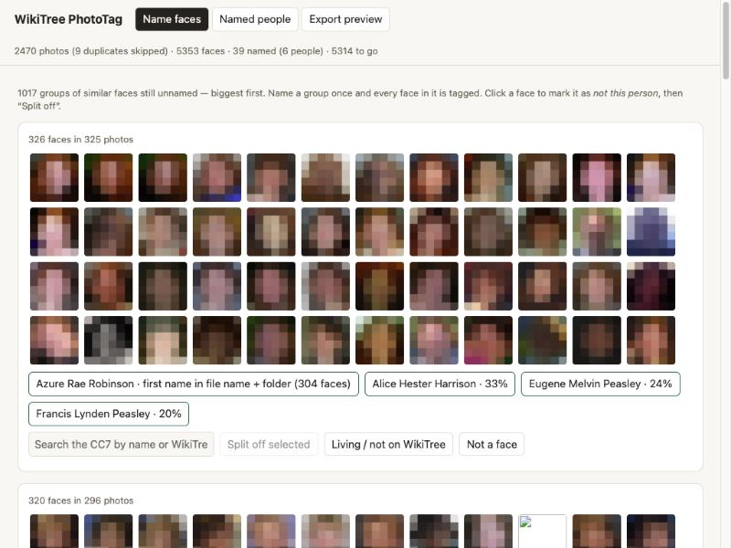
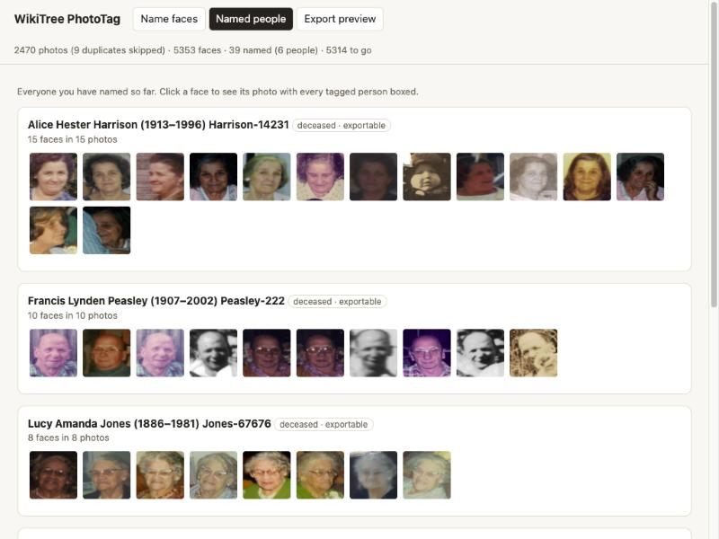
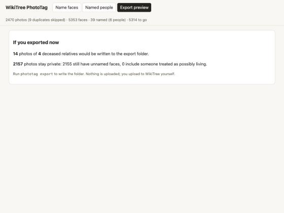
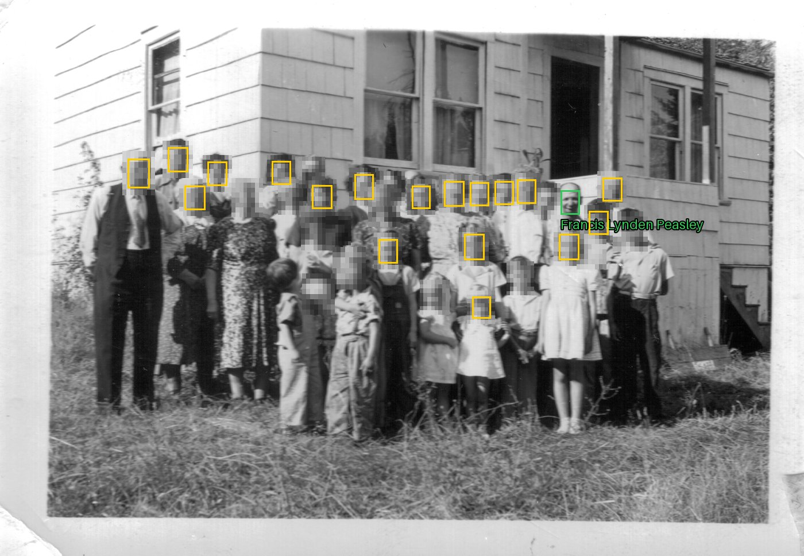

# WikiTree PhotoTag

> Unofficial community tool. Not affiliated with or endorsed by WikiTree.

Tag the faces in a family photo album with their WikiTree ids, **entirely on your own computer**, then export only the photos of deceased relatives into one folder per WikiTree profile, ready to upload.

Built for the [Hacktoberfest Open-Source AI Challenge: Week 3](https://dev.to/challenges/hacktoberfest-week3-2026-10-19) ("Slow and Steady": make the dreaded task do itself).

```
CC7 csv ─┐
         ├─► scan ─► group look-alike faces ─► name each group ONCE ─► export
album ───┘  (open face models)                (local web page)        │
                                                                       ├─ one folder per deceased relative's WikiTree id
                                                                       ├─ captions.csv with ready-made [[Id|Name]] captions
                                                                       └─ photos with living or unnamed people never leave
```

## Why it is built this way

* **Open models, local only.** Faces are detected with YuNet (MIT) and embedded with SFace (Apache-2.0), both from the OpenCV Zoo. Captions and handwriting are read with Gemma 3 through Ollama. Nothing is uploaded: family photos often contain living people who never agreed to be on the internet.
* **The privacy gate is the product.** A photo is exported only if *every* face in it is named *and* every named person is deceased. Unnamed faces, people named only locally ("living / not on WikiTree"), ids that are not in your CC7, and anyone without a death date born after 1910 keep the photo private. The rule lives in [`phototag/export.py`](phototag/export.py) and is covered by tests.
* **Name each person once.** Similar faces are grouped (average-linkage clustering). You name a group, every face in it is tagged, and later groups are matched against the people you have already named.
* **Guesses never leave on their own.** Names from `seed` / `accept` are marked *auto*. `export` skips those photos unless you pass `--include-auto`, because a wrong guess could file a living child under a deceased relative's profile. (In testing, an album folder named for a grandfather mostly held photos of children, so folder names are hints, not facts.)
* **Uses what the tree already knows.**
  * Album folders such as `0A2 Carl William Robinson Sr` and file names such as `CarlSr_Fran_Teresa 003.jpg` become hints (nearest relatives with that first name, `Sr`/`Jr` respected).
  * A person cannot appear in a photo dated before they were born or after they died; candidates that do not fit are demoted.
  * Gemma reads handwriting on the backs of prints and looks for relatives' full names in it.
* **Non-destructive.** Originals are never modified. Exports are copies (TIFF/BMP are converted to JPEG) with an `.xmp` sidecar carrying standard face regions and the WikiTree ids as keywords.

## Use

Requires Python 3.10+. For caption reading, [Ollama](https://ollama.com) with `gemma3:4b`.

```bash
python3 -m venv .venv && .venv/bin/pip install -e .
.venv/bin/phototag init --cc7 ~/Downloads/CC7_YourId.csv --photos ~/Pictures/Family
.venv/bin/phototag models        # downloads the two open face models (~38 MB)
.venv/bin/phototag scan          # finds faces, skips duplicate files
.venv/bin/phototag read-text     # optional: Gemma reads captions on scans without faces
.venv/bin/phototag seed          # optional: a one-face photo named "Alice Hester Harrison 001.jpg" names that face
.venv/bin/phototag cluster
.venv/bin/phototag label         # opens http://127.0.0.1:8765 : name each group once
.venv/bin/phototag label --blur  # same, but every face except named deceased people is pixelated (safe to screenshot)
.venv/bin/phototag export        # writes ./out/<WikiTree-Id>/… and captions.csv
```

The CC7 csv comes from WikiTree's CC7 tool. It has no "living" flag, so `phototag init` reports how many people it will treat as deceased. Change the cut-off with `--presumed-deceased-before`.

Uploading to WikiTree stays manual: open the profile, add the photo, paste the caption from `captions.csv`.

## Demo (faces of anyone who may be living are pixelated)

| Name each group once | Everyone named so far | Nothing leaves unless it is safe |
|---|---|---|
|  |  |  |

A 19-person family photo: one man is named (a deceased relative), every other face is pixelated, including faces the main detector missed (a second, more sensitive pass over-blurs).



## Limits

* The privacy gate only knows about faces the detector found. A face it missed in an exported photo is not checked, so skim exported photos before uploading.
* Face matching on faded or small scans is imperfect; that is why you confirm groups instead of trusting them, and can split a group with one click.
* Children and siblings can look alike to the model, so check the groups with young faces.
* Only the picture is judged. You still need the right to share each photo on WikiTree.

## Tests

```bash
.venv/bin/pytest
```

MIT licensed.
